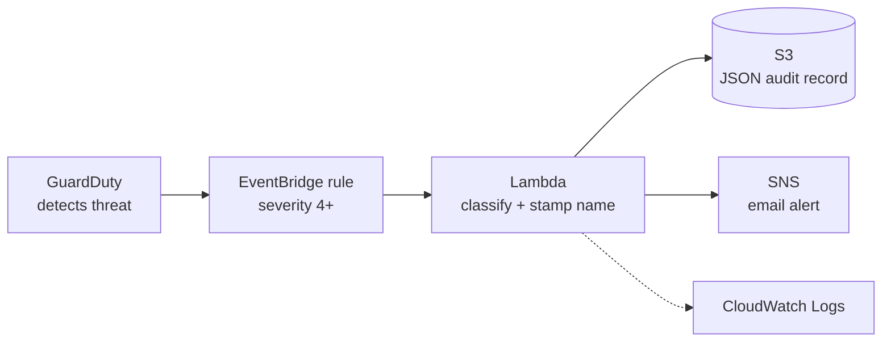
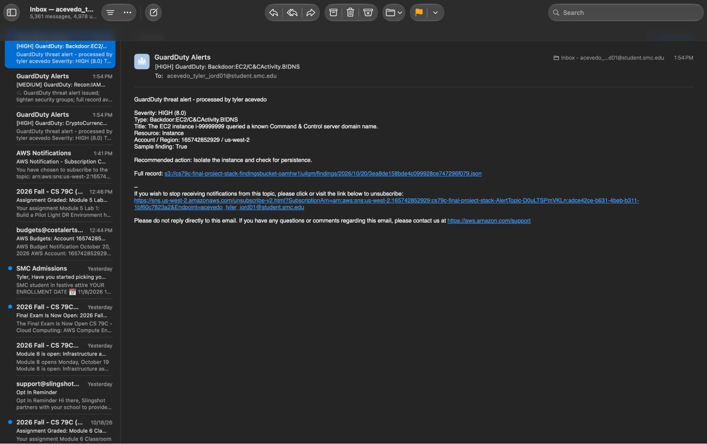
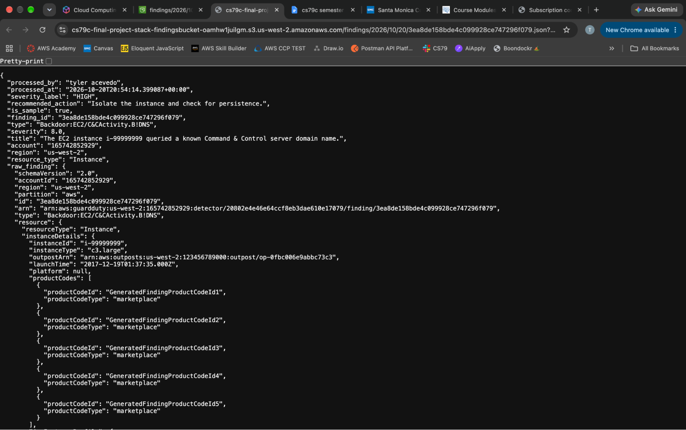
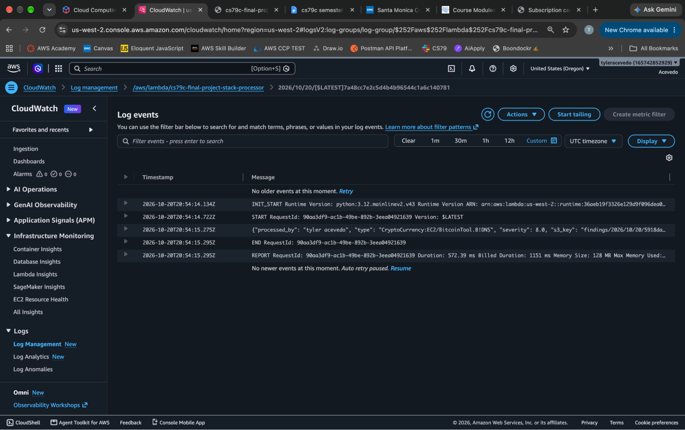

# GuardDuty Threat Detection and Response Pipeline

An event driven AWS pipeline pipeline that detects threats with Amazon GuardDuty, filters them by severity, and automatically logs and alerts on each one. Everything deploys from a single CloudFormation template.

## How it works

1. **GuardDuty** monitors the account and creates a finding when suspicious activity is detected.
2. **EventBridge** receives every finding and passes medium level and above (4+) to lambda. Low severity findings are dropped.
3. **Lambda** labels the severity, adds a recommended action based on the threat category, and stamps the owners name on the record.
4. The full record is stored in **S3** as a JSON audit trail, and a short summary is emailed through **SNS**.
5. **CloudWatch Logs** record every lambda run.

6. ## Services

| Service | Role |
|---|---|
| GuardDuty | Threat detection |
| EventBridge | Routing and severity filter |
| Lambda | Classification and formatting |
| S3 | Encrypted audit log of every finding |
| SNS | Email alerts |
| IAM | Least-privilege role for Lambda |
| CloudWatch Logs | Function logs (14-day retention) |
| CloudFormation | Deploys and deletes everything as one stack |

## Repository contents

- `template.yaml`: CloudFormation template for the whole pipeline, including the Lambda code
- `screenshots/`: deployment and test evidence, numbered in pipeline order
- `README.md`: this file

## Deploy

Region: **us-west-2**. GuardDuty must be off in the region before deploying, because the stack turns it on (AWS allows one detector per region).

1. CloudFormation → **Create stack → With new resources (standard)** → upload `template.yaml`.
2. Fill in the parameters:
   - `AlertEmail`: where alerts are sent
   - `OwnerName`: name stamped on every alert and record
   - `CreateDetector`: `true` (use `false` if GuardDuty is already on)
3. Leave the stack options at their defaults, tick the IAM acknowledgment, and submit.
4. Wait for `CREATE_COMPLETE` (about 2–3 minutes).
5. Click **Confirm subscription** in the AWS Notification email. SNS sends nothing until you do.

6. ## Test

From CloudShell, generate four sample findings. They are labeled `[SAMPLE]` and involve no real resources.

~~~bash
DET=$(aws guardduty list-detectors --region us-west-2 --query 'DetectorIds[0]' --output text)
aws guardduty create-sample-findings --region us-west-2 --detector-id $DET --finding-types 'Backdoor:EC2/C&CActivity.B!DNS' 'CryptoCurrency:EC2/BitcoinTool.B!DNS' 'Recon:IAMUser/MaliciousIPCaller' 'Policy:IAMUser/RootCredentialUsage'
~~~

The last finding is low severity. It is included to prove the filter works.

## Results

| Finding | Severity | Alert sent |
|---|---|---|
| Backdoor:EC2/C&CActivity.B!DNS | High | Yes |
| CryptoCurrency:EC2/BitcoinTool.B!DNS | High | Yes |
| Recon:IAMUser/MaliciousIPCaller | Medium | Yes |
| Policy:IAMUser/RootCredentialUsage | Low | No (filtered out) |

Three alert emails arrived within minutes, three JSON records were written to S3, and the EventBridge rule correctly blocked the low-severity finding.

Alert email, with my name in the output:

Audit record in S3:

Lambda log in CloudWatch:

All evidence is in [`screenshots/`](screenshots/).

## Security

- **Least-privilege IAM:** the Lambda role can do three things, each locked to one resource: write to its own log group, write files under `findings/` in its bucket, and publish to its topic. It cannot read or delete anything.
- **Encryption at rest:** S3 default encryption (SSE-S3).
- **Encryption in transit:** the bucket policy denies any request not made over HTTPS.
- **No public access:** all four S3 Block Public Access settings are on.
- **No personal details in code:** the email and name are parameters entered at deploy time.

## Cost

Designed to run at or near $0:

- GuardDuty: 30-day free trial
- Lambda, EventBridge, SNS, S3 and CloudWatch: within the free tier at this volume
- S3 records expire after 90 days, and logs after 14 days
- A zero-spend AWS Budget emails an alert on any charge

## Cleanup

1. Empty the S3 findings bucket. CloudFormation can't delete a bucket that still has files in it.
2. Delete the CloudFormation stack. This removes every resource, and turns GuardDuty off if `CreateDetector` was `true`.

## Limitations and next steps

- **No dead-letter queue:** if Lambda fails after its automatic retries, that alert is lost. Next step: add an SQS dead-letter queue.
- **Alerts only, no response:** the pipeline notifies but doesn't act. Next step: automatic remediation, such as moving a compromised EC2 instance into an isolation security group.
- **Email only:** add Slack or another chat channel for faster response.
- **SNS topic isn't KMS-encrypted:** could add a customer-managed KMS
